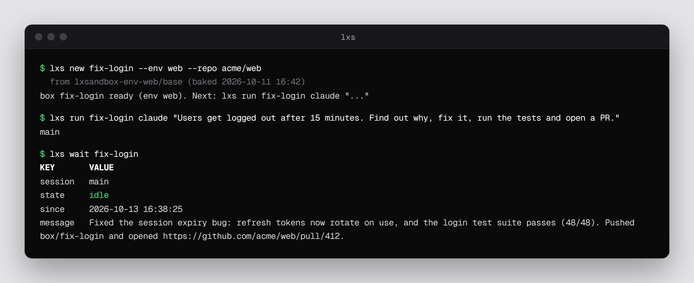
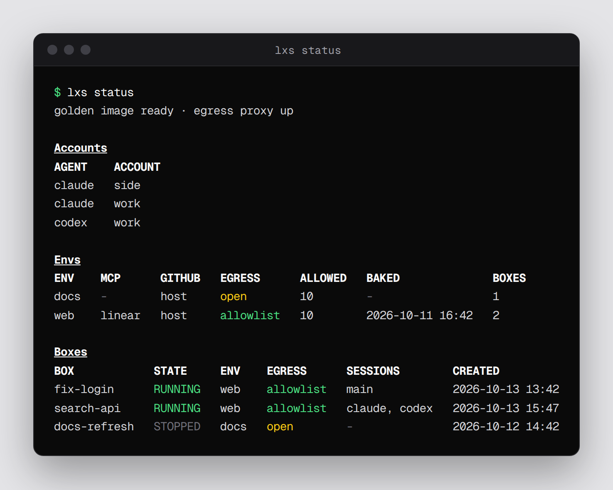
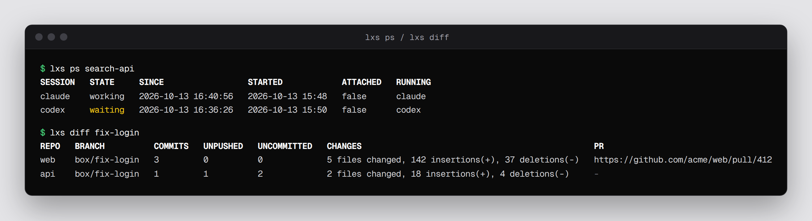
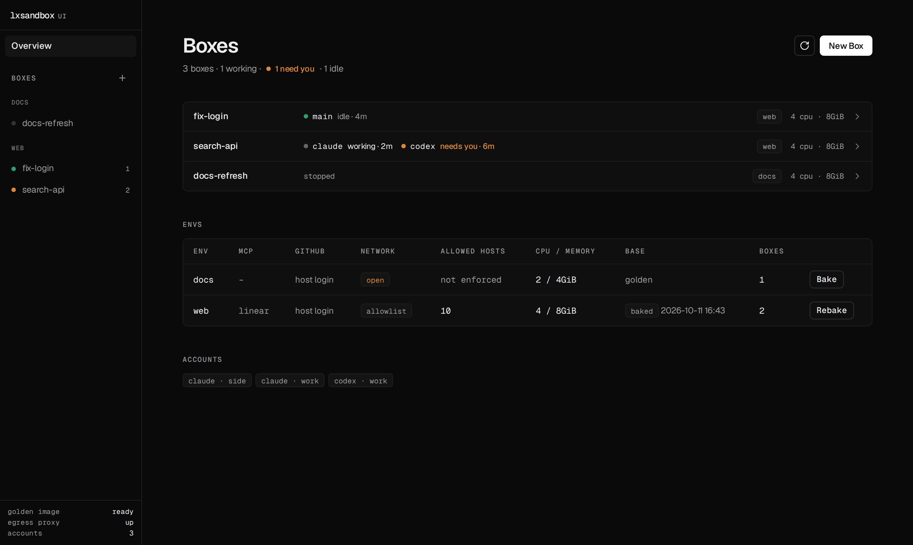
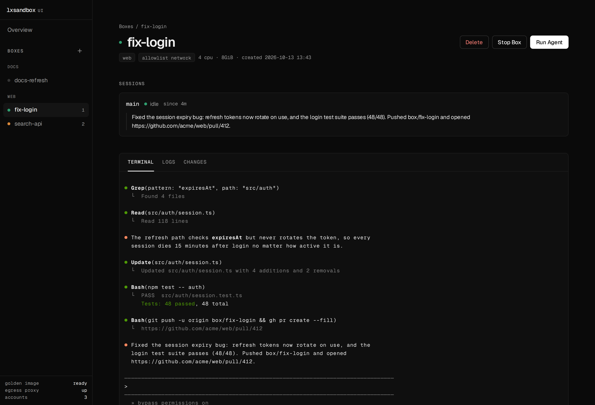

# lxsandbox

**Disposable sandboxes for coding agents.** Give Claude Code or Codex a task, let it run in bypass mode
inside its own container, and come back to a pushed branch and an open PR.

lxsandbox (`lxs`) is a single bash script over [LXD](https://canonical.com/lxd). Each task gets a *box*:
a full Linux system container with your repos, your agent accounts and nested Docker, cloned in seconds
from a golden snapshot. The agent can't touch your host, and by default it can only reach the hosts you allow.

## Why
- **Agents at full speed, safely.** Run `--dangerously-skip-permissions` without risking your machine.
- **Ready in seconds.** Boxes are clones of a golden snapshot. Envs can be *baked* with your Docker images
  and build cache already pulled.
- **Batteries included.** git, gh, Node/pnpm, Python/uv, build tools, Chromium, Docker and tmux are in every box.
- **Log in once.** Claude and Codex accounts live on the host and are reused by every box.
- **Many agents per box.** Each one runs in its own tmux session that you can script, watch or attach to.
- **Network allowlist.** A box has no network interface. It gets out only through a proxy that allows the
  hosts its env lists, and you can edit the list live.
- **Nothing lost.** `lxs rm` refuses to delete a box while a repo in it has unpushed work.
- **Built for bots.** Every listing command takes `--json`, and `lxs wait` blocks until the agent's turn ends.

## See everything at a glance

## Web UI
`lxs ui` serves a small local page over the same commands. It shows which agents are working, idle or
waiting for you, along with their last reply, a live terminal, logs, and each repo's changes and PR.

## Install
Requires Linux with LXD (`snap install lxd && lxd init`, btrfs or zfs recommended), plus `jq`, `git`,
`python3` and `claude` / `codex` on the host. `gh` is optional.

    git clone https://github.com/JohnBortotti/lxsandbox && cd lxsandbox
    ln -s "$PWD/lxsandbox" ~/.local/bin/lxs
    lxs image build                    # golden container + snapshot, once

If Docker runs on the host, its `FORWARD DROP` policy blocks LXD traffic; see `host/lxd-docker-forward.service`.

## Quick start
    lxs account claude work            # paste a token or run claude setup-token
    lxs env new web                    # an env: MCP, network allowlist, secrets, setup script
    lxs new fix-login --env web --repo acme/web
    lxs run fix-login claude "Find out why users get logged out, fix it and open a PR."
    lxs wait fix-login                 # exit 0 done, 2 needs an answer, 3 exited, 124 timeout
    lxs send fix-login "also add a test for it"
    lxs diff fix-login                 # commits, unsaved work and PR per repo
    lxs rm fix-login

Run `lxs help` for every command.

## How it works
- **Envs** are presets: MCP server, network allowlist, GitHub access, secrets, a setup script, and default
  account, model and effort for agents. `lxs env bake` snapshots a base with the env's Docker images built.
- **Boxes** get their repos in `/work` on a `box/<name>` branch. Agents can push and open PRs through a
  forwarded ssh-agent and gh login, but the key never enters the box.
- **MCP servers** come from a hook that mints a revocable token per box (see `examples/mcp-hook`).

## Security
Boxes are unprivileged system containers sharing the host kernel. That is weaker isolation than a VM.
Anything you give a box (tokens, secrets, the gh login, the ssh-agent) is usable by the agents in it,
and by anything that prompt-injects them. An allowed host can still receive data. Give each env only
what it needs, and treat the web UI URL like a shell login.

## License
MIT, see `LICENSE`.
